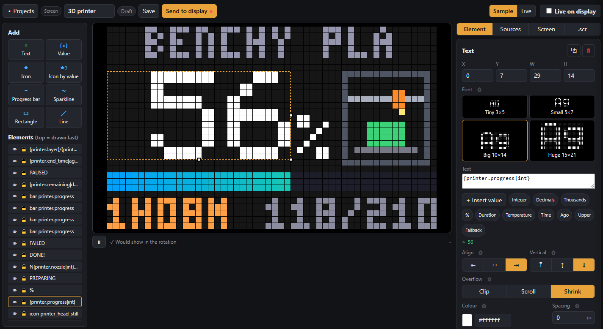
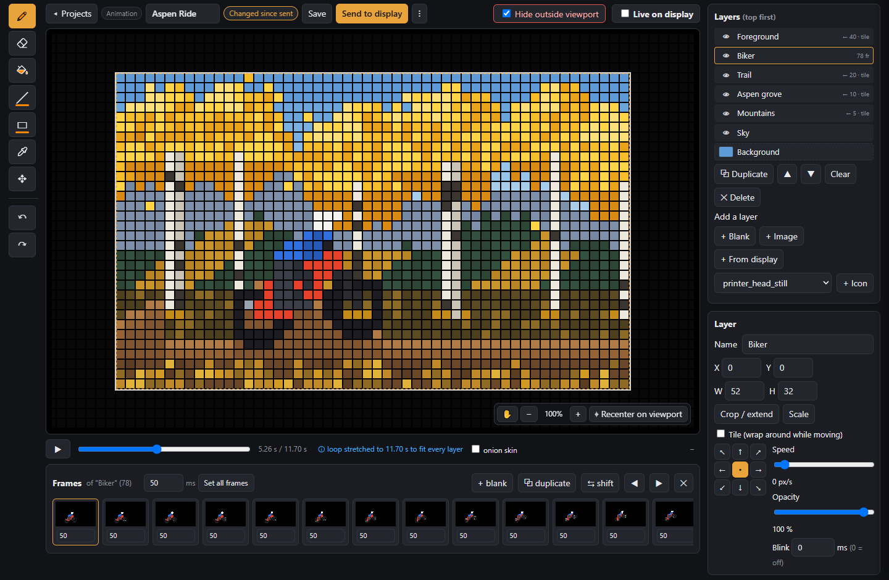

# pixel2mqtt

A bridge and web editor for **Govee H6631 52×32 pixel displays running custom firmware** (the `pixeld` daemon from
[pixeld-h6631](https://github.com/JinjAdmin/pixeld-h6631)). It works like zigbee2mqtt: one container connects any
number of displays to your MQTT broker and Home Assistant, and gives you a web editor to design what they show.



## Contents

- [What it does](#what-it-does)
  - [More screenshots](#more-screenshots)
- [Installation](#installation)
  - [Requirements](#requirements)
  - [Home Assistant OS: install as an app (add-on)](#home-assistant-os-install-as-an-app-add-on)
  - [Docker](#docker)
  - [Without Docker](#without-docker)
  - [Adopt a display](#adopt-a-display)
- [Reference](#reference)
  - [Configuration](#configuration)
  - [MQTT topics](#mqtt-topics)
  - [How it works](#how-it-works)
  - [Tests](#tests)
- [Artwork and licence](#artwork-and-licence)

## What it does

- **Home Assistant bridge.** Every display shows up in Home Assistant through MQTT discovery, with one MQTT login
  for all of them. The displays themselves need no MQTT credentials.
- **Info screens.** Lay out text, icons, progress bars, sparklines and shapes, and bind them to Home Assistant
  entities (state, attributes, history, weather forecasts). pixel2mqtt keeps the values up to date.
  - **Template screens**: one layout for a group of similar entities (e.g. every stock ticker), picked in Home
    Assistant or rotating.
  - **Exposed settings**: turn any screen setting (font, colour, a chart's time window, …) into a Home Assistant
    entity.
- **Animation and icon editor.** Layered animations with per-layer motion, tiling and frames; animated icons;
  GIF/PNG import; **Live on display** streams the canvas to the panel at about 30 fps while you edit.
- **Library.** Browse each display's animations, icons, sounds and screens with previews; play, rename, delete and
  remove duplicates.
- **Built-in artwork import.** Converts the animations and icons inside your own display's firmware, and the scenes
  the Govee app sent to it, into editable files. *pixel2mqtt contains no artwork.*

Everything you send is stored **on the display**, so it keeps working when the container is down.

**How to use it:** the [guide](docs/GUIDE.md) covers everything after installation: your first screen, binding
Home Assistant data, template screens, exposed settings, animations, icons and playlists. It also opens inside
pixel2mqtt from the **?** button.

### More screenshots

**Animation editor**: "Aspen Ride", six layers (sky; mountains, aspen grove, trail and foreground scrolling at their
own speeds; a 78-frame biker), with the frame strip below and the layer settings on the right.



**Sources**: the 3D printer screen's values, each bound to a Home Assistant entity, with samples for the preview.


**Library** and **Displays**:


## Installation

### Requirements
- One or more H6631 displays running [pixeld-h6631](https://github.com/JinjAdmin/pixeld-h6631) with the LAN API
  (`api: 1` in `http://<display>/api/info`). Info screens need a version with screen support.
- An MQTT broker (e.g. Mosquitto) and Home Assistant with the MQTT integration.
- Home Assistant OS, Docker, or Python ≥ 3.8 (no third-party packages).

### Home Assistant OS: install as an app (add-on)
[](https://my.home-assistant.io/redirect/supervisor_add_addon_repository/?repository_url=https%3A%2F%2Fgithub.com%2FJinjAdmin%2Fpixel2mqtt-addon)

Add the repository `https://github.com/JinjAdmin/pixel2mqtt-addon` under Settings → Apps → Install app → ⋮ →
Repositories (older versions: Add-ons → Add-on Store), then install **pixel2mqtt**. It uses the Mosquitto app's
login and Home Assistant's API automatically, and its web UI opens inside Home Assistant. Details: the
[add-on documentation](https://github.com/JinjAdmin/pixel2mqtt-addon/blob/main/pixel2mqtt/DOCS.md).

### Docker
Save this as `docker-compose.yml` and run `docker compose up -d`. The image `swilli23/pixel2mqtt` is built for
amd64 and arm64.

```yaml
services:
  pixel2mqtt:
    image: swilli23/pixel2mqtt:latest
    container_name: pixel2mqtt
    restart: unless-stopped
    network_mode: host          # needed for LAN discovery (UDP broadcast) and the live preview
    volumes:
      - ./data:/app/data        # adopted displays (with their API tokens), projects, settings
    # Every setting is optional; see Configuration below.
    # environment:
      # MQTT_HOST: localhost
      # MQTT_USER: pixel2mqtt
      # MQTT_PASSWORD_FILE: /run/secrets/mqtt_password
      # HA_URL: http://homeassistant.local:8123      # for info screen values
      # HA_TOKEN_FILE: /run/secrets/ha_token         # a long-lived access token, in a file
```

With host networking and a broker on the same machine, no settings are needed. If your broker requires a login,
create a dedicated user (Mosquitto: `mosquitto_passwd /mosquitto/config/passwd pixel2mqtt`, then restart it) and
set `MQTT_USER` and `MQTT_PASSWORD`. On a bridge network the discovery broadcast can't reach the displays, so list
them in `PIXEL_HOSTS`. The `docker-compose.yml` in this repository is a shorter version that reads `.env`.

**Image tags:** `:latest` is the newest release; `:0.4` or `:0.4.3` pin a version; `:edge` follows the main branch
(finished, not yet released); `:beta` is the most recently pushed feature branch (experimental).

### Without Docker
```sh
python -m pixel2mqtt          # reads .env and ./data (or set PIXEL2MQTT_DATA)
```

### Adopt a display
Open `http://<server>:8466/`, go to **Displays**, click **Scan the network**, then **Adopt**:

1. The display shows a **6-digit code** on its panel for 2 minutes. Type it in.
2. The display issues an API token, which pixel2mqtt stores in `data/devices.json`. Keep that file private.
3. Choose the Home Assistant name. New displays get the base topic `pixel2mqtt/<name>/`.
   If the display was already using MQTT directly (pixeld's built-in client), tick **Keep existing entities** to
   keep its `govee-pixel/…` topics and unique ids, so your entities, dashboards and automations keep working.
   Only one display can use these topics.

While pixel2mqtt is connected, the display's own MQTT client stays off. If pixel2mqtt is gone for 5 minutes, the
display reconnects to MQTT directly (if it still has its own `mqtt.conf`), and pixel2mqtt takes over again when it
comes back.

Then head to the [guide](docs/GUIDE.md).

## Reference

### Configuration
Environment variables. `.env` in the working directory and `data/.env` are also read, and
`data/config.json` (`{"mqtt": {"host": …}, "hosts": […]}`) works too.

| Variable | Default | |
|---|---|---|
| `MQTT_HOST`, `MQTT_PORT` | `localhost`, `1883` | `MQTT_HOST=none` runs pixel2mqtt as an editor only |
| `MQTT_USER`, `MQTT_PASSWORD` (or `MQTT_PASSWORD_FILE`) | – | Only if the broker requires a login |
| `MQTT_CLIENT_ID` | random (`pixel2mqtt-xxxxxxxx`) | Fixed id, e.g. for broker ACLs or logs. Must be unique per instance |
| `PIXEL2MQTT_BASE` | `pixel2mqtt` | Base topic |
| `HA_DISCOVERY_PREFIX` | `homeassistant` | |
| `HA_URL`, `HA_TOKEN_FILE` | – | Home Assistant's address and a file holding a long-lived access token. Used by the screen editor (entity picker, live values) and to send bound values to the displays. The add-on connects by itself. |
| `WEB_PORT` / `WEB_HOST` | `8466` / `0.0.0.0` | |
| `PIXEL_HOSTS` | – | Comma-separated display IPs (`ip` or `ip:port`) to probe directly |
| `SCAN_INTERVAL` | `120` | Seconds between network scans. Scans also follow DHCP address changes. |
| `LOG_LEVEL` | `INFO` | `DEBUG` for troubleshooting |

The web UI has **no login**. Like zigbee2mqtt's frontend, it's meant for your LAN only, so don't expose it
through a reverse proxy without adding authentication there.

### MQTT topics
The topics are pixeld's own, with the base replaced by the display's topic. Some examples:

| Topic | Payload |
|---|---|
| `<topic>/animation/set` | an animation name |
| `<topic>/text/set` | text to scroll |
| `<topic>/notify/set` | text, or JSON `{"message","duration","color","sound","animation"}` |
| `<topic>/chime/set` | a sound name, optionally with a volume |
| `<topic>/values/set` | JSON `{"name": value, ...}` for info screens (pixel2mqtt sends bound values itself) |
| `<topic>/screen/set` | `Auto`, or an info screen's name to pin it |
| `<topic>/playlist/set` | `kind[:arg]:secs,…`, e.g. `clock:30,info:40,screen:Ticker:20` |
| `<topic>/group/<screen>/select`, `…/rotate` | a template screen's member (or `Rotate`) and rotate seconds |
| `<topic>/control/<screen>/<setting>/set` | an exposed screen setting (see the [guide](docs/GUIDE.md#mqtt-for-exposed-settings)) |
| `<topic>/status` | `online` / `offline` (pixel2mqtt sets this) |
| `pixel2mqtt/bridge/state` | `online` / `offline` (last will) |

Every entity's availability depends on both the bridge and the display.

### How it works
- **Display side (pixeld, port 80):** an authenticated HTTP API (`/api/info`, `/api/pair`, `/api/storage`,
  `/api/files/<anims|icons|sounds|screens>[/<file>]`, `/api/res`, `/api/cmd/<name>`, `/api/frame`).
  `/api/discovery` returns every MQTT message pixeld would publish itself, and `/api/events` long-polls everything
  it publishes afterwards. Discovery answers on UDP 7778; raw frames go to UDP 7777.
- **pixel2mqtt** mirrors `/api/discovery` and `/api/events` to MQTT, rewriting topics, unique ids and availability,
  and forwards `<topic>/+/set` to `/api/cmd`. It reads bound entities from Home Assistant and sends their values to
  the displays.
- **Files:** animations are baked to `.anim` (`PXA1`: u16 count, then per frame u16 delay plus 52×32 RGB), icons to
  `.pxi` (`PXI1`: w, h, u16 count, then per frame u16 delay plus RGBA), screens to `.scr` (see pixeld's
  [SCREENS.md](https://github.com/JinjAdmin/pixeld-h6631/blob/main/docs/SCREENS.md)). Sounds are stored as they
  are; the display decodes them on first play.

### Tests
`python tests/test_offline.py`, `python -m tests.test_bindings` (and `test_groups`, `test_controls`,
`test_forecast`, `test_history`), `node tests/test_scene.js` and `node tests/test_screens.js` need nothing else
(CI runs `test_offline` and `test_scene`). `test_screens.js` also checks the screen renderer pixel for pixel
against pixeld's golden frames when a pixeld-h6631 checkout sits next to this one.
`tests/verify_stock_scenes.py <copy of /usr/res>` (local, needs the stock files) checks that every built-in
animation opened as layers bakes byte-identically.
`tests/run_pixeld_host.sh <pixeld-h6631 checkout> [<copy of a display's /usr/res>]` builds pixeld for x86-64 with a
stub panel and runs it in an unprivileged user and network namespace. It covers the API, pairing, uploads, events,
the MQTT bridge and, optionally, the built-in artwork importer. On Linux it needs `zig` and `unshare`.

## Artwork and licence
MIT (see [LICENSE](LICENSE)). Govee's artwork belongs to Govee: pixel2mqtt never ships it, the `.gitignore` blocks
converted files, and imported artwork stays on your own display.
