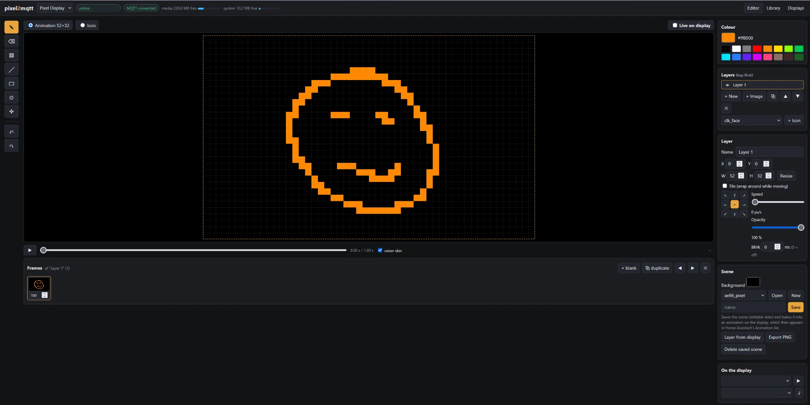
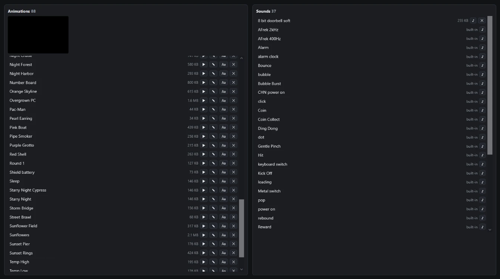
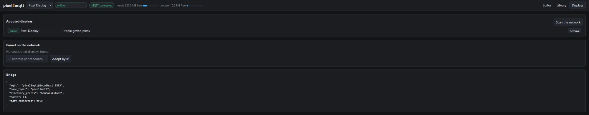

# pixel2mqtt

A small bridge and web editor for **Govee H6631 52×32 pixel displays running custom firmware** (the `pixeld`
daemon from [pixeld-h6631](https://github.com/JinjAdmin/pixeld-h6631)). It works like zigbee2mqtt: one container talks to your MQTT
broker and Home Assistant for any number of displays. You get:

- **One MQTT login for every display.** pixel2mqtt publishes Home Assistant discovery and state for each display,
  and forwards commands to it. The displays themselves don't need MQTT credentials.
- **A web editor:**
  - upload GIFs, PNGs (or any image the browser can open) and MP3/WAV/OGG sounds;
  - browse each display's animations, icons and sounds, with previews, then play, rename or delete them;
  - **remove duplicates**: identical animations collapse to one, keeping a real name over an `App …` copy;
  - a **layered animation editor** (see below);
  - draw new icons, including animated ones, and add them to the icon library;
  - see each display's free storage;
  - with **Live on display**, the real panel shows the canvas at about 30 fps while you edit.
- **Built-in artwork import.** One button converts the animations and icons that ship inside the display's own
  firmware (59 animations including 4 clock scenes, plus about 85 icons). The conversion uses a scene renderer
  tuned on real hardware: motion direction, layer order, static items and seamless loops.
  The same button imports **scenes the Govee app sent to the display** before the custom firmware was installed
  (anything you applied from the app, including community Share Space scenes). The app keeps no titles on the
  device, so they arrive as `App <code>`: rename them with the **Aa** button and later imports keep your names.
  Copies of built-ins are skipped. (Needs pixeld-h6631 v0.2.0 or newer.)
  *pixel2mqtt contains no artwork.* It reads the files from your own display and writes the results back to it.

**New to the editor?** See the [editor guide](docs/GUIDE.md) for projects, tools, layers, frames and icons.

### Screenshots
**Editor**: layers, frames, motion and opacity, with the colour palette and scene controls on the right.



**Library**: each display's animations and sounds; play, open in the editor, rename (Aa) or delete.
**Displays**: adopted displays, network discovery and the bridge status.





### Animation editor
Animations are built from **layers** (top of the list = drawn on top). Each layer has:
- its own pixels, any size up to 256×256 (bigger than the screen for scrolling backgrounds);
- one or more **frames**, each with its own duration (frame strip under the canvas, with onion skin);
- a position, plus **motion** (direction pad and speed in px/s) and **tiling** (the layer wraps around while it
  moves, like Govee's scrolling skies);
- **opacity** and **blink** (on/off every N ms).

Add layers as blank, from an image or GIF (GIF frames become layer frames), from an icon, or from the display's
current frame. ▶ plays the scene, and **Live on display** shows it on the panel while you edit.

**Tools:** pencil, eraser, fill, line, shape (rectangle, oval, triangle, diamond, trapezoid; outline or filled)
and eyedropper. Hover a tool for its settings (size, brush tip, colour); every tool keeps its own.

**Projects.** The Editor opens on a start screen: start a new animation or icon (icon size chosen up front),
import a project file, or open a copy of any animation on the display. Your work is a **project** stored by
pixel2mqtt: **Save** (and autosave every few seconds) keeps it editable without touching the display, and
**Send to display** bakes it into a seamless loop under the project's name. Every moving layer's speed is nudged
so it wraps a whole number of times per loop, and the result appears in Home Assistant's Animation list. The
status shows *Draft*, *On display* or *Changed since sent*, and pixel2mqtt warns before replacing something on the
display that wasn't made from that project. Projects can be exported and imported as `.pixel2mqtt.json` files.

Opening an animation from the display starts a copy. The built-in Govee scenes (Coffee Cat, Banana, Lighthouse,
Starry Night, …) open as their real layers with their motion settings, so they're easy to remix. Sending one
unchanged reproduces the stock animation exactly; `tests/verify_stock_scenes.py` checks this for all 59.

Everything you make is **saved on the display** (`.anim`, `.pxi` and sound files), so the displays keep working
when the container is down.

## Requirements
- One or more H6631 displays running [pixeld-h6631](https://github.com/JinjAdmin/pixeld-h6631) with the LAN
  API (`api: 1` in `http://<display>/api/info`).
- An MQTT broker (e.g. Mosquitto) and Home Assistant with the MQTT integration.
- Docker, or Python ≥ 3.8 to run it directly. It uses no third-party packages.

## Home Assistant OS: install as an app (add-on)
[](https://my.home-assistant.io/redirect/supervisor_add_addon_repository/?repository_url=https%3A%2F%2Fgithub.com%2FJinjAdmin%2Fpixel2mqtt-addon)

Running Home Assistant OS (or Supervised)? Add the repository `https://github.com/JinjAdmin/pixel2mqtt-addon`
under Settings → Apps → Install app → ⋮ → Repositories (older versions: Add-ons → Add-on Store), then install
**pixel2mqtt**. It uses the Mosquitto app's login automatically, and its web UI opens inside Home Assistant
(Ingress). Details: the [add-on documentation](https://github.com/JinjAdmin/pixel2mqtt-addon/blob/main/pixel2mqtt/DOCS.md).

Running Home Assistant in a container instead? Use Docker as below.

## Quick start (Docker)
Save this as `docker-compose.yml` and run `docker compose up -d`. The image `swilli23/pixel2mqtt` is built for
amd64 and arm64. (The `docker-compose.yml` in this repository is a shorter version that reads settings from
`.env` instead.)

```yaml
services:
  pixel2mqtt:
    image: swilli23/pixel2mqtt:latest
    container_name: pixel2mqtt
    restart: unless-stopped
    network_mode: host          # needed for LAN discovery (UDP broadcast) and the live preview
    volumes:
      - ./data:/app/data        # adopted displays (with their API tokens), projects, settings
    # Every setting is optional. Uncomment what you need; the values shown are the defaults.
    # environment:
      # --- MQTT broker ---
      # MQTT_HOST: localhost            # "none" = editor only, no MQTT
      # MQTT_PORT: 1883
      # MQTT_USER: pixel2mqtt           # only if the broker requires a login
      # MQTT_PASSWORD: change-me        # or keep it in a file:
      # MQTT_PASSWORD_FILE: /run/secrets/mqtt_password
      # MQTT_CLIENT_ID: pixel2mqtt      # default: random per start; must be unique per instance
      # --- Home Assistant ---
      # PIXEL2MQTT_BASE: pixel2mqtt     # base topic
      # HA_DISCOVERY_PREFIX: homeassistant
      # --- displays ---
      # PIXEL_HOSTS: 192.168.1.50,192.168.1.51   # probe these directly (needed without host networking)
      # SCAN_INTERVAL: 120              # seconds between network scans
      # --- web editor ---
      # WEB_PORT: 8466
      # WEB_HOST: 0.0.0.0
      # --- logging ---
      # LOG_LEVEL: INFO                 # DEBUG for troubleshooting
    # Settings can also go in a .env file (see .env.example) instead of the environment block:
    # env_file:
    #   - path: .env
    #     required: false
```

`latest` is the newest release. To stay on one version, use `:0.4` (gets 0.4.x fixes) or an exact version
such as `:0.4.2`. `:edge` follows the main branch: the newest changes, not yet released.

Open `http://<server>:8466/`, go to **Displays**, click **Scan the network**, then **Adopt**.

The compose file uses `network_mode: host`. Discovery is a UDP broadcast on port 7778, and the live preview sends
UDP to port 7777 on the display. On a bridge network the broadcast can't reach the displays, so list them in
`PIXEL_HOSTS` instead.

With host networking and a broker on the same machine, no settings are needed: pixel2mqtt connects to
`localhost:1883`. If your broker requires a login, create a dedicated user (with Mosquitto:
`mosquitto_passwd /mosquitto/config/passwd pixel2mqtt`, then restart the broker) and set `MQTT_USER` and
`MQTT_PASSWORD`.

### Without Docker
```sh
python -m pixel2mqtt          # reads .env and ./data (or set PIXEL2MQTT_DATA)
```

## Adopting a display
1. **Adopt** asks the display to show a **6-digit code** on its panel for 2 minutes.
2. Type the code in. The display issues an API token, and pixel2mqtt stores it in `data/devices.json`.
   Keep that file private.
3. Choose the Home Assistant name. New displays get the base topic `pixel2mqtt/<name>/`.
   - **Keep existing entities:** if the display was already using MQTT directly (pixeld's built-in client),
     tick this box. pixel2mqtt then keeps pixeld's own `govee-pixel/…` topics and unique ids, so your entities,
     dashboards and automations keep working. Only one display can use these topics.

While pixel2mqtt is connected, the display's own MQTT client stays off. If pixel2mqtt is gone for **5 minutes**,
the display reconnects to MQTT directly, but only if it still has its own `mqtt.conf`. In that case Home Assistant
keeps working without the container. When pixel2mqtt comes back, it takes over again automatically.

## MQTT / Home Assistant
The topics are pixeld's own, with the base replaced by the display's topic. Some examples:

| Topic | Payload |
|---|---|
| `<topic>/animation/set` | an animation name |
| `<topic>/text/set` | text to scroll |
| `<topic>/notify/set` | text, or JSON `{"message","duration","color","sound","animation"}` |
| `<topic>/weather/set`, `climate/set`, `stock/set`, `score/set` | JSON for the info screens |
| `<topic>/chime/set` | a sound name, optionally with a volume |
| `<topic>/status` | `online` / `offline` (pixel2mqtt sets this) |
| `pixel2mqtt/bridge/state` | `online` / `offline` (last will) |

Every entity's availability depends on both the bridge and the display. An upload or delete updates the
**Animation** and **Sound** dropdowns in Home Assistant within a few seconds.

## Configuration
These are environment variables. `.env` in the working directory and `data/.env` are also read.
`data/config.json` (`{"mqtt": {"host": …}, "hosts": […]}`) works too.

| Variable | Default | |
|---|---|---|
| `MQTT_HOST`, `MQTT_PORT` | `localhost`, `1883` | `MQTT_HOST=none` runs pixel2mqtt as an editor only |
| `MQTT_USER`, `MQTT_PASSWORD` (or `MQTT_PASSWORD_FILE`) | – | Only if the broker requires a login |
| `MQTT_CLIENT_ID` | random (`pixel2mqtt-xxxxxxxx`) | Fixed id, e.g. for broker ACLs or logs. Must be unique per instance |
| `PIXEL2MQTT_BASE` | `pixel2mqtt` | Base topic |
| `HA_DISCOVERY_PREFIX` | `homeassistant` | |
| `WEB_PORT` / `WEB_HOST` | `8466` / `0.0.0.0` | |
| `PIXEL_HOSTS` | – | Comma-separated display IPs (`ip` or `ip:port`) to probe directly |
| `SCAN_INTERVAL` | `120` | Seconds between network scans. Scans also follow DHCP address changes. |
| `LOG_LEVEL` | `INFO` | `DEBUG` for troubleshooting |

The web UI has **no login**. Like zigbee2mqtt's frontend, it's meant for your LAN only, so don't expose it
through a reverse proxy without adding authentication there.

## How it works
- **Display side (pixeld, port 80):**
  - authenticated HTTP API: `/api/info`, `/api/pair`, `/api/storage`, `/api/files/<anims|icons|sounds>[/<file>]`
    (GET/PUT/DELETE), `/api/res` (read-only stock files), `/api/cmd/<name>`, `/api/frame`;
  - `/api/discovery` returns every MQTT message pixeld would publish itself;
  - `/api/events` is a long-poll of everything it publishes afterwards;
  - discovery answers on UDP 7778, and raw frames go to UDP 7777.
- **pixel2mqtt** mirrors `/api/discovery` and `/api/events` to MQTT. It rewrites topics, unique ids and
  availability on the way, and forwards `<topic>/+/set` to `/api/cmd`.
- Uploads are converted in the container:
  - GIF/PNG → `.anim` (`PXA1`: u16 count, then per frame u16 delay plus 52×32 RGB);
  - GIF/PNG → `.pxi` icons (`PXI1`: w, h, u16 count, then per frame u16 delay plus RGBA);
  - sounds are stored as they are, and the display decodes them on first play.

## Tests
`python tests/test_offline.py` and `node tests/test_scene.js` need nothing else and run in CI.
`tests/verify_stock_scenes.py <copy of /usr/res>` (local, needs the stock files) checks that every built-in animation
opened as layers bakes byte-identically.
`tests/run_pixeld_host.sh <pixeld-h6631 checkout> [<copy of a display's /usr/res>]` builds pixeld for x86-64
with a stub panel. It then runs pixeld in an unprivileged user and network namespace with a fake root. The tests
cover the API, pairing, uploads, events, the MQTT bridge (against a tiny in-process broker) and, optionally, the
built-in artwork importer. On Linux it needs `zig` and `unshare`.

## Artwork and licences
Govee's artwork belongs to Govee. pixel2mqtt never ships it, and the `.gitignore` blocks converted files.
Imported artwork stays on your own display.

## Licence
MIT (see [LICENSE](LICENSE)). Govee artwork is not covered and is never included.
