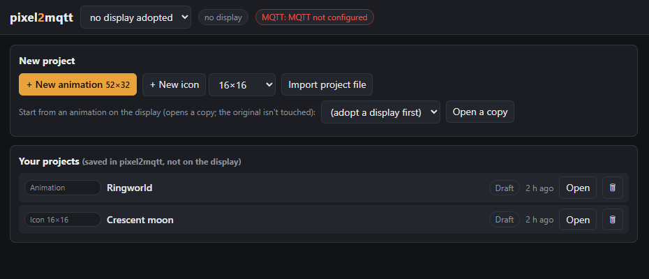
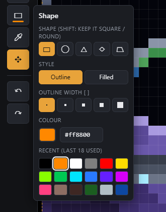
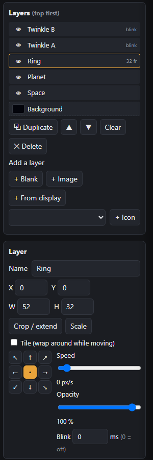
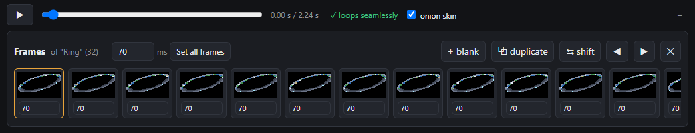

# Editor guide

This guide covers how to use the pixel2mqtt editor to make animations and icons for the 52×32 display. To install pixel2mqtt, see the [README](../README.md). Inside pixel2mqtt, the **?** button at the top right opens this guide in a side drawer.

## Projects

The **Editor** tab opens on the project screen.

- **+ New animation** starts a blank 52×32 scene.
- **+ New icon** starts a small icon. Pick its size from the list next to it first.
- **Import project file** opens a `.json` file you exported earlier.
- **Open a copy** starts from an animation that's already on the display. The copy is named "… (copy)", so the original stays untouched until you choose to replace it.
- **Your projects** lists everything saved in pixel2mqtt. Projects live in pixel2mqtt's data folder (the add-on's `/data` on HA OS), not on the display.

### Save vs Send to display

The bar above the canvas shows the project type and its name (click the name to rename it), followed by its status:

| Status | Meaning |
|---|---|
| Draft | Never sent to the display |
| Edited | Changed since it was last sent |
| On display | The display has the current version |

- **Save** stores the project in pixel2mqtt. The editor also autosaves every few seconds and when you leave the page, so a work in progress is never lost.
- **Send to display** uploads the finished scene to the display. If an animation with that name already exists there and didn't come from this project, you're asked before it's overwritten.
- The **⋮** menu has Duplicate project, Export project file, Export PNG and Delete project.
- **◂ Projects** saves and goes back to the project screen.

## Tools

The toolbar sits on the left. Hover a tool to open its settings. On touch screens, tap the tool again instead. Every tool remembers its own settings, so you can switch between a 1-px pencil and a large eraser without changing anything.

| Tool | Key | Settings |
|---|---|---|
| Pencil | P | size, square or round tip, colour |
| Eraser | E | size, tip |
| Fill (bucket) | F | colour |
| Line | L | size, tip, colour |
| Shape | S | shape, outline or filled, outline width, colour |
| Eyedropper | I | picks a colour for the tool you used before it |
| Move | M | drags the layer around |

- Each tool's icon shows its current colour, and the cursor shows the tool you're using.
- `[` and `]` change the brush size.
- Right-click erases with the pencil and line tools.
- Ctrl+Z undoes and Ctrl+Y redoes.

The **Shape** tool draws a rectangle, oval, triangle, diamond or trapezoid inside the box you drag. Hold **Shift** to keep it square or round.

## Layers

A scene is a stack of layers. The top of the list is drawn on top. The eye icon hides a layer while you edit.

- **Duplicate**, **▲ ▼**, **Clear** and **Delete** act on the selected layer.
- **Add a layer:** **+ Blank**, **+ Image** (a PNG or GIF scaled to fit), **+ From display** (a layer from an animation on the display) or **+ Icon** (one of your icon projects).
- **Background** sets the colour behind every layer. Tick **transparent** for none.

The **Layer** panel holds the selected layer's settings:

- **Name**
- **X / Y** position
- **W / H** size, changed with **Crop / extend** (keeps the pixels) or **Scale** (resizes them)
- **Tile**, which wraps the layer around while it moves
- **Motion**, a direction and speed that scrolls the layer, for example clouds or rain
- **Opacity**
- **Blink**, which switches the layer on and off at a set interval

## Frames

Each layer has its own frames, so a spinning object and a still background can sit in one scene.

- The number under each frame is how long it stays up, in milliseconds.
- To give every frame of the selected layer the same duration, type it next to **Frames** and press **Set all frames** (or Enter).
- **+ blank** adds an empty frame, and **duplicate** copies the current one, which is the quickest way to animate small changes.
- **◀ ▶** reorder frames and **✕** deletes one.
- **Onion skin** faintly shows the previous frame while you draw.
- ▶ plays the whole scene. The slider scrubs through it and shows the loop length.

**Seamless loops:** the scene loops at the length of its longest layer. To avoid a jump at the loop point, make the other layers' lengths and any blink intervals divide evenly into that loop. For example, in a 2.24 s loop, use blinks of 560 ms or 1120 ms.

## Icons

An icon project is a single small image (8×8 to 32×32) for info screens and notifications. Animation-only controls such as motion, blink and the live preview are hidden. To change the icon's size, use **⋮ → Change icon size…**.

## Testing

**Test on the display** plays any animation or music style on the panel straight away, without changing the project you're editing.

## Worked example: Ringworld

A spinning ring in front of a planet, in five layers:

1. **Space:** a dark-blue background with a few pencil-drawn stars and a faint nebula drawn with a large round brush.
2. **Planet:** a filled **Shape → Oval**, with shading added in a darker colour using the pencil.
3. **Ring:** a thin outline oval in front of the planet, with a strip of "land" colours along it. The land pattern repeats every 32 pixels. Each of the 32 frames (**duplicate**, then shift the pattern one pixel) is 70 ms long, set in one go with **Set all frames**. Because the pattern's period equals the frame count, the last frame flows straight back into the first.
4. **Twinkle A / Twinkle B:** a few bright pixels on separate layers, blinking at 560 ms and 1120 ms, which both divide evenly into the 2.24 s loop.

**Save** while working, then **Send to display** when it's done.
