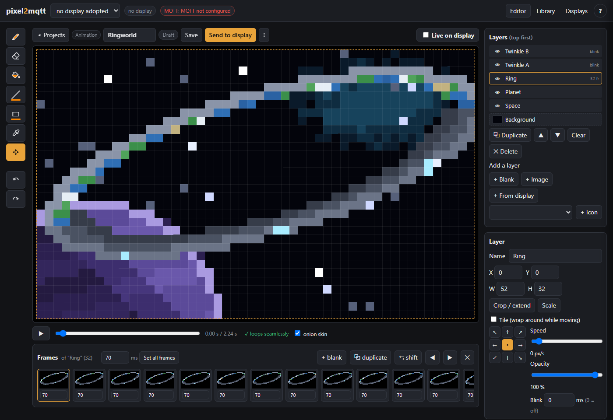
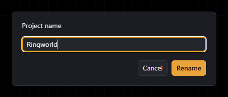
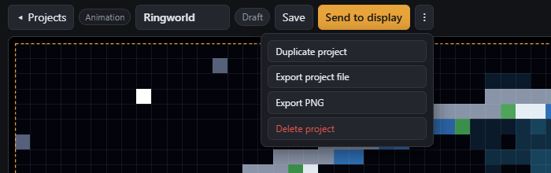
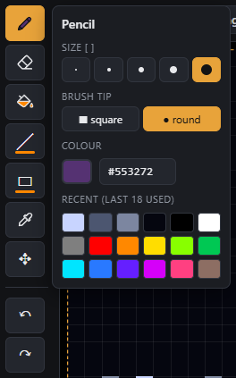
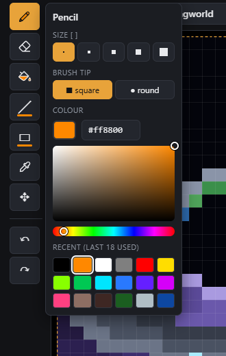
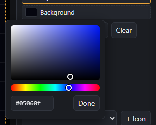
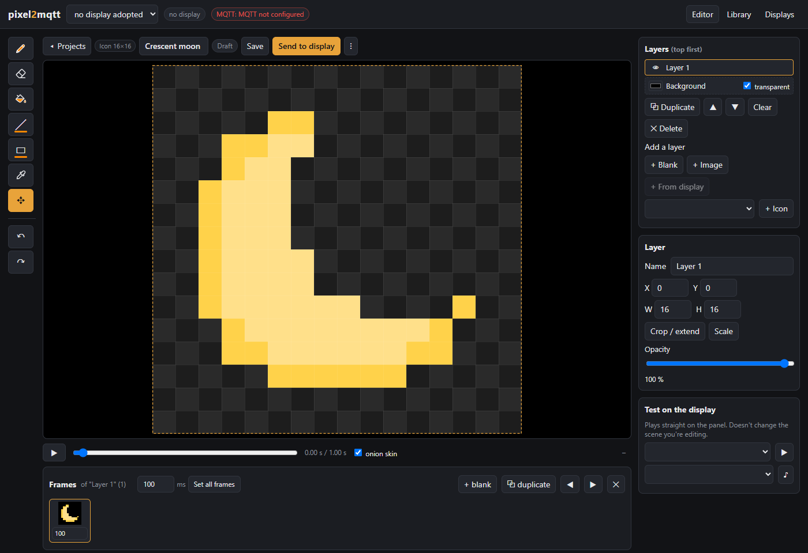
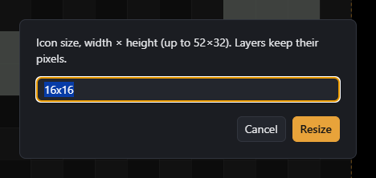

# Editor guide

This guide covers how to use the pixel2mqtt editor to make animations, icons and info screens for the 52×32 display. To install pixel2mqtt, see the [README](../README.md). Inside pixel2mqtt, the **?** button at the top right opens this guide in a side drawer.

All the screenshots come from one example project, **Ringworld**: a close-up of a vast ring-shaped world turning in front of its gas giant, with a dropship heading in, in the spirit of a certain classic sci-fi game menu. The last section walks through how each of its nine layers was made, and between them they use almost every feature of the editor.

## Projects

The **Editor** tab opens on the project screen.

- **+ New animation** starts a blank 52×32 scene.
- **+ New icon** starts a small icon. Pick its size from the list next to it first.
- **Import project file** opens a `.json` file you exported earlier.
- **Open a copy** starts from an animation that's already on the display. The copy is named "… (copy)", so the original stays untouched until you choose to replace it.
- **Your projects** lists everything saved in pixel2mqtt. Projects live in pixel2mqtt's data folder (the add-on's `/data` on HA OS), not on the display.

Click the project's name in the bar above the canvas to rename it.

### Save vs Send to display

The bar above the canvas shows the project type, its name and its status:

| Status | Meaning |
|---|---|
| Draft | Never sent to the display |
| Changed since sent | The display has an older version |
| On display | The display has the current version |

- **Save** stores the project in pixel2mqtt. The editor also autosaves every few seconds and when you leave the page, so a work in progress is never lost. The dot after the name means there are unsaved changes.
- **Send to display** uploads the finished scene to the display. If an animation with that name already exists there and didn't come from this project, you're asked before it's overwritten.
- The **⋮** menu has Duplicate project, Export project file (a `.pixel2mqtt.json` you can import elsewhere), Export PNG (the current frame) and Delete project.
- **◂ Projects** saves and goes back to the project screen.

## Tools

The toolbar sits on the left. Hover a tool to open its settings. On touch screens, tap the tool again instead. Every tool remembers its own settings, so you can switch between a 1-px pencil and a large eraser without changing anything.

| Tool | Key | Settings |
|---|---|---|
| Pencil | P | size, square or round tip, colour |
| Eraser | E | size, tip |
| Fill (bucket) | F | colour. Fills the connected area of the same colour |
| Line | L | size, tip, colour |
| Shape | S | shape, outline or filled, outline width, colour |
| Eyedropper | I | picks a colour off the canvas for the tool you used before it, then switches back to that tool |
| Move | M | drags the layer around; arrow keys nudge it by a pixel |

- Each tool's icon shows its current colour, and the cursor shows the tool you're using.
- `[` and `]` change the brush size, and Space plays or pauses.
- Right-click erases with the pencil and line tools.
- Ctrl+Z undoes and Ctrl+Y (or Ctrl+Shift+Z) redoes.

### Colours

Click the colour swatch in a tool's settings to open the picker: drag in the square for the shade and along the bar for the hue. You can also type a hex code such as `#ff8800` or `#f80`. Below it, the palette keeps the **last 18 colours you painted with**, newest first, topped up with a default set until you've used 18.

### Shapes

The **Shape** tool draws a rectangle, oval, triangle, diamond or trapezoid inside the box you drag, as an outline or filled. Hold **Shift** to keep it square or round. You can drag beyond the edge of the canvas: Ringworld's planet is a big oval that only shows its top-right corner.

## Layers

A scene is a stack of layers. The top of the list is drawn on top. The eye icon hides a layer while you edit, and the small tags show what each layer does (frames, motion, tile, blink).

- **Duplicate**, **▲ ▼** (move up or down the stack), **Clear** and **Delete** act on the selected layer. **Clear** empties the current frame; Shift+click clears every frame of the layer.
- **Add a layer:** **+ Blank**, **+ Image** (a PNG or GIF from your computer; a GIF keeps its frames), **+ From display** (whatever the display is showing right now) or **+ Icon** (an icon from the display's library).
- **Background** is the colour behind every layer. Click its swatch to pick it. Icons can use a **transparent** background instead.

### Layer settings

The **Layer** panel holds the selected layer's settings:

- **Name**.
- **X / Y**: where the layer's top-left corner sits. Layers can be smaller or larger than the screen, and can hang off its edges.
- **W / H**: the layer's size. Type a new size, then press:
  - **Crop / extend** to keep the pixels as they are, cutting off or adding empty space on the right and bottom;
  - **Scale** to resize the picture to fit (nearest-neighbour, so pixel art stays crisp).

  A layer can be up to 256 × 256, which is how you make a long scrolling background that doesn't repeat every 52 pixels. The canvas is a workspace around the panel (the white box, also called the viewport). Outside it, the other layers are dimmed and the selected layer is shown at full brightness, so you can draw the parts that scroll in later. A tiled layer shows one whole tile there, starting from the panel's top-left corner.
  - **Zoom** with the mouse wheel (around the cursor), the **−** / **+** buttons at the bottom right of the canvas, or the − and + keys.
  - **Pan** by dragging with the middle mouse button, with Alt + drag, or with the **✋** button (H) switched on.
  - **⌖ Recenter on viewport** (0) fits the panel in the middle again.
  - **Hide outside viewport**, next to Live on display, shows the panel only. Drawing outside it then does nothing.
- **Tile** repeats the layer across the whole screen, so a moving layer wraps around instead of sliding off.
- **Motion** (the arrow pad) and **Speed** scroll the layer in one of eight directions. To keep the loop seamless, the speed is adjusted slightly so the layer wraps around a whole number of times per loop. A small tiled layer can scroll more slowly than a full-width one: Ringworld's stars are a 26-pixel tile, so they drift at about 4 px/s.
- **Opacity**: how solid the layer is, from 100 % (covers what's underneath) to 0 % (invisible). In between, the layer is blended with the layers below it, which is good for haze, glows, shadows and nebulae. The display has no see-through pixels of its own; the blending is worked out when the scene is sent.
- **Blink** switches the layer on and off every so many milliseconds (0 = off). One blink cycle is on plus off, so twice the blink time.

| Opacity 100 % | Opacity 55 % |
|---|---|
|  |  |

## Frames

Each layer has its own frames, so a turning ring, a blinking star and a still planet can share a scene.

- The number under each frame is how long it stays up, in milliseconds.
- To give every frame of the selected layer the same duration, type it next to **Frames** and press **Set all frames** (or Enter).
- **+ blank** adds an empty frame, and **duplicate** copies the current one, which is the quickest way to animate small changes.
- **◀ ▶** reorder frames and **✕** deletes one.
- **Onion skin** faintly shows the previous frame while you draw.
- ▶ plays the whole scene. The slider scrubs through it.

### Shifting pixels and making frames

**⇆ shift** opens two tools:

- **Shift pixels** moves this frame (or all frames) one pixel left, up, down or right. With **wrap around** on, whatever leaves one edge comes back in at the other. **Shift + arrow keys** do the same from the keyboard.
- **Make frames** adds a run of frames after the current one, each moved a further x, y pixels: the quick way to animate clouds, water, comets or a scrolling texture. **fit loop** picks the count where the last frame flows straight back into the first. For example, a 32×16 layer moving −2, 1 each frame comes back round after 16 frames.

### Seamless loops

The scene loops once every layer's frames and blinks have repeated a whole number of times. The hint next to the time tells you how it went:

- **✓ loops seamlessly**: everything fits.
- **ⓘ loop stretched**: the loop had to be made longer than the longest layer so everything fits. That's fine, but check it isn't longer than you meant.
- **⚠ … won't loop evenly**: that layer jumps at the loop point.

Hover the hint for each layer's breakdown. In Ringworld, everything is built around a 6.4 s loop: 64 frames × 100 ms for the ring, 16 × 400 ms for the comet, and blinks of 800 and 1600 ms (cycles of 1.6 and 3.2 s).

## Icons

An icon project is a single small image (8×8 to 32×32, or any size up to 52×32 with **custom…**) for info screens and notifications. Icons can have several frames and a transparent background. Animation-only controls such as motion, blink and the live preview are hidden. To change the size later, use **⋮ → Change icon size…**. Layers keep their pixels; nothing is stretched.

## Screens

A **screen** is an info screen for the display's Info rotation: text, values from Home Assistant, icons, progress
bars, sparklines and shapes, laid out on the 52×32 panel. The display keeps them up to date: pixel2mqtt sends the
values whenever they change in Home Assistant. Screens need a display running pixeld-h6631 with screen support.

Start one with **+ New screen**, or **From example…** (Today, Forecast, 3D printer and Ticker) on the Projects page.

- **Add** an element from the left: **Text**, **Value** (a text that opens the entity picker straight away),
  **Icon**, **Icon by value** (a different icon for each state, e.g. the weather), **Progress bar**, **Sparkline**,
  **Rectangle** or **Line**. Click to add it, or drag it onto the canvas.
- On the canvas, **click** to select, **drag** to move (it snaps to the panel's centre lines and to other elements'
  edges; hold Alt to place it freely) and drag the white handles to resize. Arrow keys nudge by 1 pixel, Shift +
  arrows by 5, Delete removes it, Ctrl+Z undoes.
- **Elements** (left) lists them in drawing order, top = drawn last. Drag to reorder, 👁 hides one while editing
  (it's still sent), 🔒 stops it moving. ⚠ marks a problem: hover for details.
- The **Element** tab sets position and size, the **font** (Tiny 3×5, Small 5×7, Big 10×14, Huge 15×21: the panel
  has no sizes in between), alignment within the box, what happens when the text is too wide (clip, scroll or
  shrink), the colour, **colour rules** (e.g. green when a price is up) and **Show when** (e.g. only while printing).
- Text is a **template**: `{printer.progress|int}%` shows a value run through formatters. **+ Insert value** picks
  one, and the chips add formatters: Integer, Decimals, Thousands, %, Duration, Temperature, Time, Ago, Upper and
  Fallback. The result shows underneath as you type.
- **Values** lists every value the screen uses. **Bind** connects one to a Home Assistant entity: its state, one of
  its attributes, or its **history** (for sparklines). A weather entity also offers its **forecast**: now (this hour), today, tonight or up to three days ahead, as temperature, high, low, condition or day name, with the temperature unit attached. The entity picker searches names, ids, devices, areas and
  integrations (words in any order), or browses Area → Device → Entity. Each value also has a **sample**, so you can
  try states like `finish` without waiting for a real print. **Sample / Live** at the top switches the preview
  between samples and Home Assistant's live values.
- **Screen** holds the screen's settings: its name in Home Assistant's *Screen* select, the values it **needs**
  before it shows, **Show when**, **Keep showing after** (e.g. 30 minutes after a print finishes), when values count
  as stale, time on screen, order in the rotation and background. **.scr** shows the file that gets sent.
- **Send to display** uploads the screen and starts sending its bound values (batched, about once a second, and
  again whenever the display restarts). **Remove from display** takes it off and stops its values.

**Template screens (groups).** One screen can show any of several similar entities, such as every stock ticker. In
**Screen**, turn on **Group** and pick the members: every entity of an integration (e.g. `easy_stock`), a label, a
device, an entity type or a list. Then, in **Values**, take each value from the group with **◫ Group** (state, an
attribute or history, with display forms such as *Short symbol* `^GSPC → S&P`). The member picker at the top of
Values previews any member. After **Send to display**, Home Assistant gets a dropdown with every member plus
**Rotate**, and a number for the rotate time. Rotate steps through the members every N seconds, all of a member's
values change together, and new members (a new ticker in Easy Stock) appear in the dropdown by themselves.

**Home Assistant controls.** Any screen setting can become an entity on the display's device in Home Assistant. Tick it
under **Control from Home Assistant**: element settings (font, alignment, colour, blink, a bar's range, a sparkline's
shading, ...) are in the element's panel, and screen settings (time on screen, order, background, stale after, and
each sparkline's history window) are in **Screen**. Each control has a name (default "<screen> <setting>", e.g.
*Market chart history*) and a type: a number (min, max, step, unit), a dropdown (options, comma-separated), a switch
or text. After **Send to display**, a change in Home Assistant is checked against that range or list, saved, and on
the display within a second or two (a history window resends the sparkline). Opening the screen in the editor picks
up what Home Assistant changed. Unticking a control, or deleting the screen, removes its entity. A group's member
dropdown and rotate time are built-in controls of the same kind.

MQTT: discovery under `<prefix>/<number|select|switch|text>/<display>/scr_<screen>_<setting>/config`, commands on
`<topic>/control/<screen>/<setting>/set`, state on `.../state`. Unique ids are `<display>_scr_<screen>_<setting>`, so
renaming a screen makes new entities.

Home Assistant access is automatic in the add-on. In Docker, set `HA_URL` and `HA_TOKEN_FILE` (see the README).
Without it, values are plain names: publish them yourself to `<topic>/values/set`, and the Values tab shows an
example automation.

## Testing on the display

These need a display adopted on the **Displays** tab:

- **Live on display** (above the canvas) streams the canvas to the panel at about 30 fps while you work, including playback.
- **Test on the display** plays any animation or music style on the panel straight away, without changing the project you're editing.
- **+ From display** grabs whatever the panel is showing as a new layer, and **+ Icon** adds one of the display's icons as a layer.

## Worked example: Ringworld

From the bottom of the stack up:

1. **Background**: set to a near-black blue with the background swatch.
2. **Stars**: Layer 1, cropped to 26×32 with **Crop / extend**, then dotted with stars using the pencil. With **Tile** on and Motion **←**, it drifts slowly behind everything.
3. **Nebula**: a few strokes with a size-6 **round** pencil in three purples, then **Opacity** 55 % so the stars show through.
4. **Planet**: an **outline oval** from the Shape tool, dragged far beyond the bottom-left corner, filled with the **bucket**, with two darker bands from the **Line** tool. The **eyedropper** then picked up the rim colour for the pencil, and a round brush thickened the lit edge.
5. **Comet**: a 32×16 layer (**Crop / extend**) with a six-pixel streak. **Make frames** moved it −2, 1 per frame, **fit loop** made it 16 frames, and **Set all frames** gave each 400 ms.
6. **Dropship**: a 32×12 gunmetal dropship drawn in an image editor and added with **+ Image**, **Scale**d down to 16×6, extended to 52×32, pushed down 25 pixels with **Shift pixels**, then set to **Tile** and Motion **→** so it flies across in front of the planet. **▼** moved it below the ring, so it passes behind the land.
7. **Ring inner surface** and 8. **Ring hull**: the showpiece. These are two layers of 64 frames each (100 ms), with the hull's plating and the land rising behind it turned a little further round every frame. It's the most work in the scene. For simpler scrolling textures, **Make frames** does it for you.
9. **Twinkle A** (three stars, **Blink** 800 ms), then **Duplicate**d to make **Twinkle B**, nudged to new spots with **Shift + arrow keys**, and given a slower blink of 1600 ms.

The loop hint shows **✓ loops seamlessly** at 6.4 s. **Save** while working, then **Send to display** when it's done.
