# pixel2mqtt guide

How to make info screens, animations and icons for the 52×32 display, and how to wire them to Home Assistant.
To install pixel2mqtt, see the [README](../README.md). Inside pixel2mqtt, the **?** button at the top right opens
this guide in a side drawer.

**Contents:** [Getting started](#getting-started) · [Screens](#screens) ([editor](#the-screen-editor-at-a-glance),
[elements](#elements), [text](#text-and-values), [sources](#sources-binds), [showing and hiding](#showing-and-hiding),
[templates](#template-screens-groups), [exposed settings](#exposed-settings-controls),
[sending](#sending-and-the-rotation)) · [Animations and icons](#animations-and-icons) ·
[Playlists](#playlists-and-the-info-rotation) · [Reference](#reference)

## Getting started

pixel2mqtt has three tabs:

- **Displays**: find displays on the network (**Scan the network**), **Adopt** them (type the 6-digit code shown on
  the panel) and see the bridge's MQTT and Home Assistant status.
- **Library**: what's on the selected display (animations, icons, sounds and screens) with previews. Play, show,
  open in the editor, rename or delete, and see the free storage. **Projects not on this display** lists your
  projects with **Open** and **Send**.
- **Editor**: opens on the projects page. Start a **+ New screen** (or **From example…**: Today, Forecast,
  3D printer, Ticker), a **+ New animation** or a **+ New icon**, import a project file, open a copy of an
  animation that's on the display, or reopen one of **Your projects**.

Projects are saved in pixel2mqtt's data folder (`/data` in the add-on), not on the display. **Save** (and autosave
every few seconds) keeps a project editable; **Send to display** uploads the finished screen, animation or icon.
The status next to the project's name says where it stands:

| Status | Meaning |
|---|---|
| Draft | Never sent to the display |
| Changed since sent | The display has an older version (Send shows a red dot) |
| On display | The display has the current version |

Click the project's name to rename it. The **⋮** menu has duplicate, export (`.pixel2mqtt.json`, PNG) and delete.
**◂ Projects** saves and goes back.

**Docker image tags.** `:latest` is the newest release, `:0.4` or `:0.4.3` pin a version, `:edge` follows the main
branch (finished but not yet released) and `:beta` is the most recently pushed feature branch (experimental). The
add-on follows releases.

## Screens

A **screen** is an info screen in the display's Info rotation: text, Home Assistant values, icons, bars, sparklines
and shapes. pixel2mqtt sends new values whenever they change. Screens need pixeld-h6631 with screen support.

> **Binds vs exposed settings.** A **bind** (the Sources tab) brings data *from* Home Assistant *into* the screen,
> e.g. `sensor.printer_progress` → `printer.progress`. An **exposed setting** works the other way: it turns a
> screen setting (a colour, the time on screen) into an entity that Home Assistant can *change*.

### The screen editor at a glance

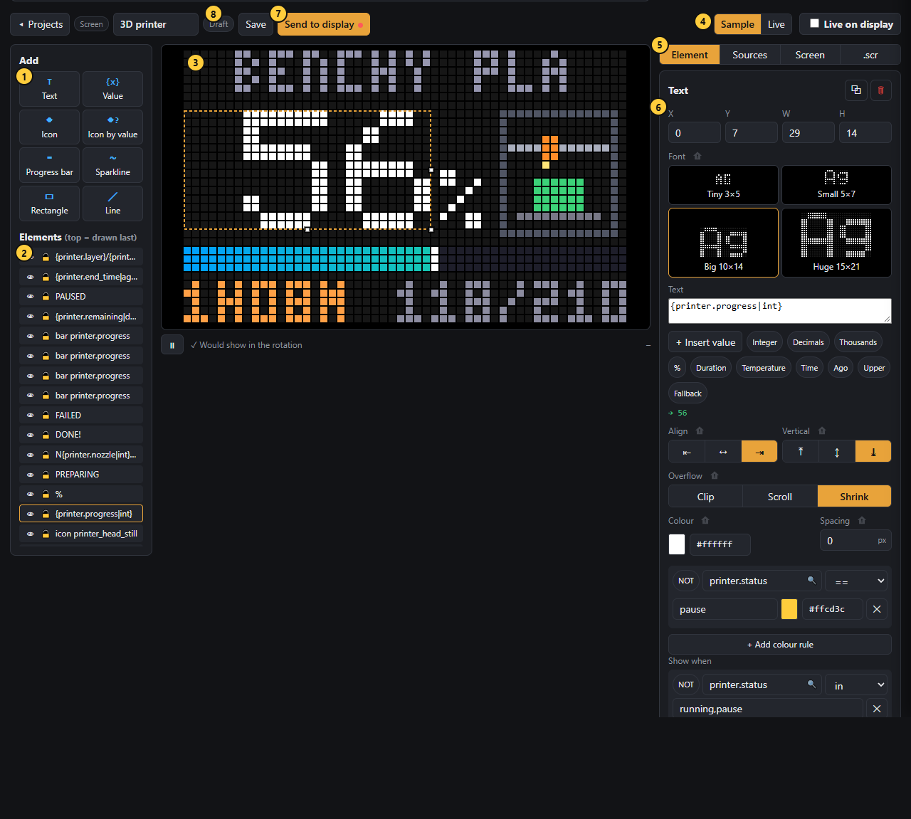

1. **Add**: click an element type to add it, or drag it onto the canvas.
2. **Elements**: the drawing order (top = drawn last). Drag to reorder; 👁 hides, 🔒 locks, ⚠ marks a problem.
3. **Canvas**: click to select, drag to move (snaps to centre lines and other elements; Alt places freely), drag
   the white handles to resize. Arrows nudge 1 px, Shift + arrows 5 px.
4. **Sample / Live**: preview with sample values or Home Assistant's live values.
5. **Tabs**: **Element** (the selected element), **Sources** (binds), **Screen** (the whole screen), **.scr**
   (the file that gets sent).
6. **Settings** for the selected element. Duplicate and delete are in its header.
7. **Send to display**: uploads the screen. A red dot means there are unsent changes.
8. **Status**: Draft, Changed since sent or On display.

### Elements

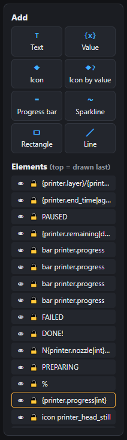

| Element | Shows |
|---|---|
| Text | a template with values, e.g. `{printer.progress}%` |
| Value | text that opens the entity picker straight away |
| Icon | an icon from the display's library, or a built-in `@` icon |
| Icon by value | one icon per state, e.g. the weather (`*` = anything else) |
| Progress bar | a value between Min and Max; optional end colour, empty colour, direction, blinking edge |
| Sparkline | a list value, usually a History bind; optional shading and blinking newest point |
| Rectangle, Line | shapes; a rectangle can be filled |

Every element has X, Y (and W, H), a **Colour**, **Show when** and **Blink**.

### Text and values

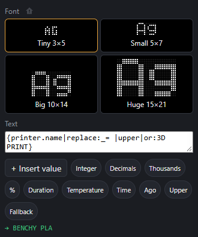

- **Font**: Tiny 3×5, Small 5×7, Big 10×14, Huge 15×21, each drawn at the panel's scale. No sizes in between.
- **Text** is a template: a value goes in braces, formatters after `|`, e.g. `{printer.name|upper|or:3D PRINT}`.
- **+ Insert value** picks a value; the chips add formatters: Integer, Decimals, Thousands, %, Duration,
  Temperature, Time, Ago, Upper, Fallback. The result shows under the chips.
- **Align**, **Vertical** and **Overflow** (clip, scroll or shrink) act within the box, so set W (and H) first.

### Sources (binds)

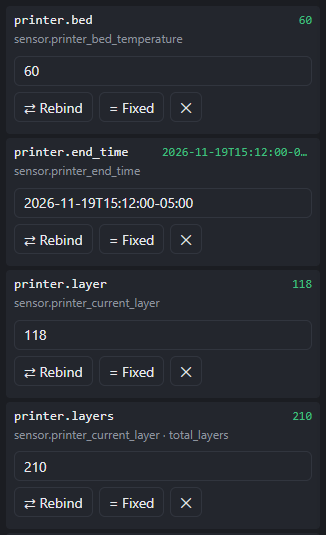

A bind connects a Home Assistant entity to a value name the screen uses (`printer.progress`). Every name the
screen uses is listed:

1. **Bind** to pick the entity (search names, ids, devices, areas and integrations, or browse Area → Device →
   Entity → Attribute), or **= Fixed** for a constant.
2. Type a **sample** in the box beside it to preview a state without waiting for it (e.g. `finish`).

| Kind | Value | Example |
|---|---|---|
| State | the entity's state, with its unit | `sensor.outside_temperature` → `[63, "°F"]` |
| Attribute | one attribute | `weather.home` → `humidity` |
| History | the last N hours as a list, for a sparkline | 24 h, 48 points |
| Fixed | a constant | `BTC` |
| Group | from a template screen's current member | the member's `symbol` as *Short symbol* |
| Forecast | a weather entity's forecast | *Tomorrow* → *High* |

- **History** skips stretches with no change for over an hour (a closed market), so trading sessions sit back to
  back. Windows over 10 days use Home Assistant's long-term statistics.
- **Forecast** periods: now, today, tonight and up to three days ahead; fields: temperature, high, low,
  condition, day name.
- Home Assistant access is automatic in the add-on. In Docker, set `HA_URL` and `HA_TOKEN_FILE` (see the README).
  Without it, publish values yourself to `<topic>/values/set`; Sources shows an example automation.

### Showing and hiding

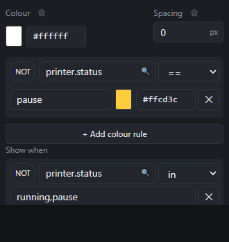

Each condition row is `[NOT] [value 🔍] [operator]` over `[compare value] [×]`. **+ AND / OR** adds a row.
Operators without a compare value (*is set*, *has a value*, *is fresh*) take one line.

| Where | Setting | Does |
|---|---|---|
| Element | **Colour** + **colour rules** | the first true rule picks the colour, e.g. yellow while `printer.status == pause` |
| Element | **Show when** | draws the element only while the condition holds |
| Screen ▸ When to show | **Needs** | hides the screen until these values exist and are fresh |
| Screen ▸ When to show | **Stale after** | a needed value older than this hides the screen (default 6h) |
| Screen ▸ When to show | **Show only when** | the screen joins the rotation only while this holds |
| Screen ▸ When to show | **Keep showing after** + **for** | keeps it a while longer, e.g. 30m after a print finishes |

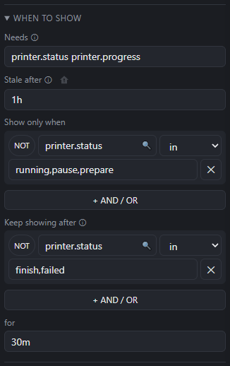

### Template screens (groups)

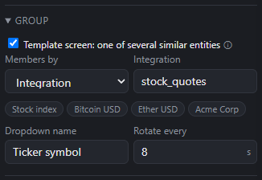

One screen shows any of several similar entities, e.g. every stock ticker.

1. **Screen ▸ Group**: tick **Template screen** and pick the members by **integration**, **label**,
   **device**, **entity type** or a list of **entities**. They show as chips.
2. **Sources**: bind values with **◫ Group** (the member's state, an attribute or its history), optionally in a
   display form like *Short symbol* (`BTC-USD` → `BTC`). The member picker at the top previews any member.
3. **Send to display.** Home Assistant gets a dropdown (*Dropdown name*) with every member plus **Rotate**, and a
   number for **Rotate every**. New members appear in the dropdown by themselves.

### Exposed settings (controls)

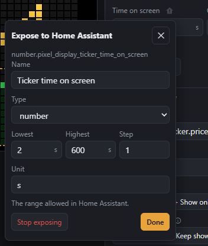

1. Click **⌂** next to a field's label. The field gets an accent edge and a popover opens.
2. Set the entity's **Name** and **Type**: number (Lowest / Highest / Step, unit), select (comma-separated
   options), switch or text. **Done**.
3. **Send to display.** The entity appears on the display's device in Home Assistant.

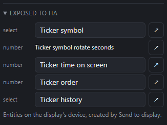

- **Screen ▸ Exposed to HA** lists every entity the screen creates, including a group's dropdown and rotate
  number. Names are editable; ↗ jumps to the field.
- Exposable: font, alignment, overflow, scroll speed, spacing, colour, blink; a bar's range, fill, direction and
  pulse; a sparkline's shading, dot and **history window** (a dropdown of `1h, 6h, 24h, 3d, 7d, 30d`); a
  rectangle's fill; the screen's time on screen, order, background and stale after.
- A change in Home Assistant is checked against the range or options and on the display within a second or two.
  Opening or sending the screen picks it up, so a Send doesn't undo it.
- **Stop exposing** (in the popover) or removing the screen removes the entity. Renaming a screen creates new
  entities.

### Sending and the rotation

- **Send to display** uploads the screen and starts its binds (values batched about once a second, resent every
  10 minutes and when the display restarts). **Remove from display** takes it off.
- **Screen ▸ On the display as** is the name in Home Assistant's *Screen* select and in playlists. **Rename**
  changes it; the project name is separate.
- **Screen ▸ Basics**: **Time on screen** (blank = the display's *Info rotate*), **Order** in the rotation
  (lower first) and **Background**.
- How screens take turns: see [Playlists and the Info rotation](#playlists-and-the-info-rotation).

## Animations and icons

The screenshots here come from one project, **Ringworld**: a ring-shaped world turning in front of its gas giant,
with a dropship heading in. Its recipe is in the [reference](#worked-example-ringworld).

### Built-in artwork and Govee app scenes
In the **Library**, **Import built-in animations & icons** converts the animations and icons inside your display's own firmware
(59 animations including 4 clock scenes, plus about 85 icons) into normal files. The same button imports scenes the
Govee app sent to the display before the custom firmware was installed, including community Share Space scenes.
The app keeps no titles on the device, so they arrive as `App <code>`: rename them with **Aa**, and later imports
keep your names. Copies of built-ins are skipped. (Needs pixeld-h6631 v0.2.0 or newer.)

Opening a built-in scene in the editor (Coffee Cat, Banana, Lighthouse, Starry Night, …) gives you its real layers
and motion settings, ready to remix. Sent unchanged, it reproduces the stock animation exactly.

pixel2mqtt contains no artwork: it reads the files from your own display and writes the results back to it.

### Tools

Hover a tool for its settings (on touch screens, tap it again). Each tool keeps its own settings.

| Tool | Key | Settings |
|---|---|---|
| Pencil | P | size, square or round tip, colour |
| Eraser | E | size, tip |
| Fill | F | colour; fills the connected area of one colour |
| Line | L | size, tip, colour |
| Shape | S | rectangle, oval, triangle, diamond or trapezoid; outline or filled; Shift keeps it square |
| Eyedropper | I | picks a colour for the previous tool, then switches back |
| Move | M | drags the layer; arrow keys nudge it |

The colour picker takes a drag or a hex code (`#ff8800`, `#f80`); its palette keeps your last 18 colours. Shapes
can be dragged past the canvas edge (Ringworld's planet is a big oval showing only its corner).

### Layers

A scene is a stack of layers; the top of the list is drawn on top. Add **+ Blank**, **+ Image** (PNG or GIF; a GIF
keeps its frames), **+ From display** (the panel's current frame) or **+ Icon**. **Duplicate**, **▲ ▼**, **Clear**
(Shift+click: every frame) and **Delete** act on the selected layer. **Background** is the colour behind everything
(icons can be transparent).

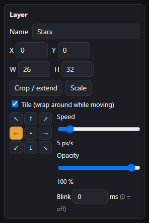

The **Layer** panel:

- **X / Y** and **W / H**: a layer can be any size up to 256×256 and hang off the edges. After typing a size,
  **Crop / extend** keeps the pixels and **Scale** resizes the picture. A layer wider than the panel scrolls
  without repeating every 52 pixels: the canvas is a workspace around the panel (the white box), with zoom
  (wheel, − / +), pan (middle mouse, Alt + drag, ✋), **⌖ Recenter on viewport** and **Hide outside viewport**.
- **Tile** repeats the layer across the screen; **Motion** and **Speed** scroll it in one of eight directions.
  Speeds are adjusted slightly so every layer wraps a whole number of times per loop.
- **Opacity** blends the layer with the ones below (worked out when the scene is sent). **Blink** switches it on
  and off every N ms.

| Opacity 100 % | Opacity 55 % |
|---|---|
| 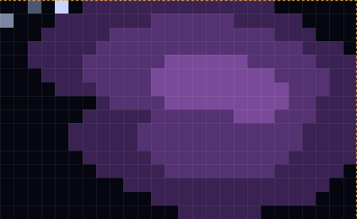 |  |

### Frames and loops

Each layer has its own frames, each with its own duration (the number under it, in ms). **Set all frames** gives
them one duration, **+ blank** and **duplicate** add frames, **◀ ▶** reorder, **✕** deletes, and **Onion skin**
shows the previous frame faintly.

**⇆ shift** moves pixels one step (with or without wrap-around; Shift + arrows does the same). **Make frames** adds
a run of frames, each moved a further x, y, and **fit loop** picks the count that flows back into the first frame.

The loop hint next to the time says **✓ loops seamlessly**, **ⓘ loop stretched** (made longer than the longest
layer so everything fits) or **⚠ … won't loop evenly** (that layer jumps). Hover it for each layer's breakdown.

### Icons

An icon is a small image for screens and notifications. It can have several frames and a transparent background.
New icons start at 16×16; change the size with **Size** in the Layers card (8×8 to 32×32, or **custom…** up to
52×32). Layers keep their pixels; nothing is stretched.

### Testing on the display

With a display adopted:

- **Live on display** streams the canvas (or the screen preview) to the panel at about 30 fps while you work.
- **Test on the display** plays any animation or music style straight away, without touching your project.
- **+ From display** grabs the panel's current frame as a layer.

## Playlists and the Info rotation

- In **Info** mode the display cycles through every screen whose *Needs*, *Show only when* and *Keep showing after*
  allow it, in **order**, each for its **time on screen** (default: the display's *Info rotate* setting).
- Home Assistant's **Screen** select pins one screen (*Auto* = the rotation). A pinned screen shows even when its
  rules say no.
- In **Playlist** mode the display runs its *Playlist* setting: `kind[:arg]:seconds` items separated by commas,
  e.g. `clock:30,info:40,animation:Moon:20,screen:Ticker:20`. `screen:<name>` uses the name from **On the display
  as**. Set it from Home Assistant or with `<topic>/playlist/set`.

## Reference

### Shortcuts

| Where | Keys |
|---|---|
| Everywhere | Ctrl+Z undo, Ctrl+Y or Ctrl+Shift+Z redo, Space play/pause |
| Animation editor | P E F L S I M tools, `[` `]` brush size, right-click erases, Shift + arrows shift pixels, H pan, 0 recenter, − + zoom |
| Screen editor | arrows nudge 1 px, Shift + arrows 5 px, Delete removes, Alt + drag places without snapping |

### MQTT for exposed settings

- Discovery: `<prefix>/<number|select|switch|text>/<display>/scr_<screen>_<setting>/config`.
- Commands: `<topic>/control/<screen>/<setting>/set`; state: `<topic>/control/<screen>/<setting>/state`.
- Unique ids: `<display>_scr_<screen>_<setting>`. A group's dropdown and rotate number keep their own ids
  (`<display>_grp_<screen>`, `…_rotate`) and topics (`<topic>/group/<screen>/select`, `…/rotate`).
- Values for screens: `<topic>/values/set` with a flat JSON object, e.g. `{"market.price": 6919.95}`.

### Worked example: Ringworld

From the bottom of the stack up:

1. **Background**: a near-black blue.
2. **Stars**: a 26×32 layer (**Crop / extend**) dotted with the pencil, **Tile** on, Motion **←**, drifting at
   about 4 px/s.
3. **Nebula**: a size-6 round pencil in three purples, **Opacity** 55 %.
4. **Planet**: an outline oval dragged far past the bottom-left corner, filled with the bucket, two darker bands
   from the Line tool, the rim colour picked up with the eyedropper and thickened with a round brush.
5. **Comet**: a 32×16 layer with a six-pixel streak; **Make frames** −2, 1, **fit loop** (16 frames), **Set all
   frames** 400 ms.
6. **Dropship**: drawn elsewhere, added with **+ Image**, **Scale**d to 16×6, extended to 52×32, shifted down,
   then **Tile** and Motion **→**; **▼** puts it behind the ring.
7. **Ring inner surface** and 8. **Ring hull**: 64 frames each at 100 ms, turned a little further every frame.
9. **Twinkle A** (Blink 800 ms), duplicated as **Twinkle B**, nudged with Shift + arrows, Blink 1600 ms.

Everything fits a 6.4 s loop: 64 × 100 ms, 16 × 400 ms, and blink cycles of 1.6 and 3.2 s.
