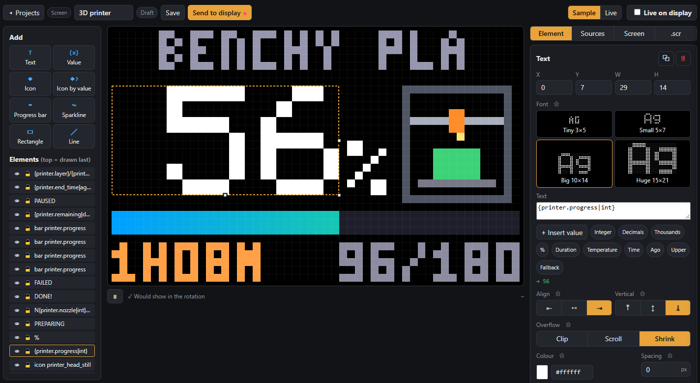
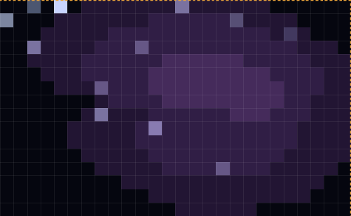
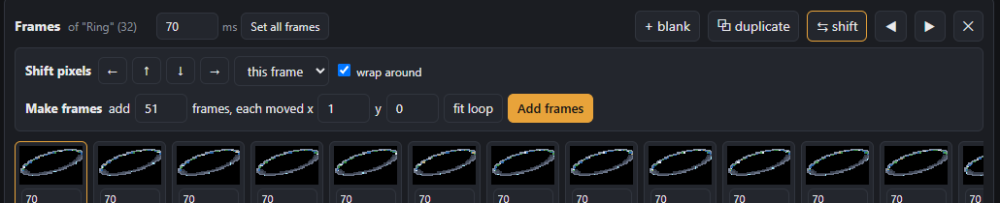

# pixel2mqtt guide

How to make info screens, animations and icons for the 52×32 display, and how to wire them to Home Assistant.
To install pixel2mqtt, see the [README](../README.md). Inside pixel2mqtt, the **?** button at the top right opens
this guide in a side drawer.

**Contents:** [Getting started](#getting-started) · [Your first screen](#your-first-screen) ·
[Binding data](#binding-data-the-sources-tab) · [Template screens](#template-screens-groups) ·
[Exposing settings](#exposing-settings-to-home-assistant) · [Animations and icons](#animations-and-icons) ·
[Playlists](#playlists-and-the-info-rotation) · [Reference](#reference)

## Getting started

pixel2mqtt has three tabs:

- **Displays**: find displays on the network (**Scan the network**), **Adopt** them (type the 6-digit code shown on
  the panel) and see the bridge's MQTT and Home Assistant status.
- **Library**: what's on the selected display (animations, icons, sounds and screens) with previews. Play, show,
  open in the editor, rename or delete, and see the free storage. **Projects not on this display** lists your
  projects with **Open** and **Send**.
- **Editor**: opens on the projects page. Start a **+ New screen** (or **From example…**: Today, Forecast,
  3D printer, Ticker), a **+ New animation** or a **+ New icon**, import a project file, open a copy of an
  animation that's on the display, or reopen one of **Your projects**.

Projects are saved in pixel2mqtt's data folder (`/data` in the add-on), not on the display. **Save** (and autosave
every few seconds) keeps a project editable; **Send to display** uploads the finished screen, animation or icon.
The status next to the project's name says where it stands:

| Status | Meaning |
|---|---|
| Draft | Never sent to the display |
| Changed since sent | The display has an older version (Send shows a red dot) |
| On display | The display has the current version |

Click the project's name to rename it. The **⋮** menu has duplicate, export (`.pixel2mqtt.json`, PNG) and delete.
**◂ Projects** saves and goes back.

**Docker image tags.** `:latest` is the newest release, `:0.4` or `:0.4.3` pin a version, `:edge` follows the main
branch (finished but not yet released) and `:beta` is the most recently pushed feature branch (experimental). The
add-on follows releases.

## Your first screen

A **screen** is an info screen in the display's Info rotation: text, values from Home Assistant, icons, progress
bars, sparklines and shapes. pixel2mqtt sends the values whenever they change, so the display stays current.
Screens need pixeld-h6631 with screen support.

1. **Add elements** from the left: **Text**, **Value** (text that opens the entity picker straight away), **Icon**,
   **Icon by value** (an icon per state, e.g. the weather), **Progress bar**, **Sparkline**, **Rectangle** or
   **Line**. Click to add, or drag onto the canvas.
2. **Place them.** Click to select, drag to move (snaps to the centre lines and other elements; Alt places freely),
   drag the white handles to resize. **Elements** on the left is the drawing order (top = drawn last): drag to
   reorder, 👁 hides while editing, 🔒 locks, ⚠ marks a problem (hover for details).
3. **Style them** in the **Element** tab. Duplicate and delete are the icons in its header.
   - **Font**: Tiny 3×5, Small 5×7, Big 10×14 and Huge 15×21, each sample drawn as LEDs at the panel's scale, so
     what you pick is what the panel shows. There are no sizes in between.
   - **Text** is a template: `{printer.progress|int}%`. **+ Insert value** picks a value and the chips add
     formatters (Integer, Decimals, Thousands, %, Duration, Temperature, Time, Ago, Upper, Fallback). The result
     shows underneath.
   - **Align**, **Vertical**, **Overflow** (clip, scroll or shrink when the text is wider than W) and **Spacing**.
   - **Colour** and **colour rules**: each rule is `[NOT] [value] [operator]` over `[compare] [colour]`, and the
     first rule that's true wins (e.g. green when `ticker.change > 0`).
   - **Show when**: show the element only while a condition holds. Operators without a compare value (*is set*,
     *has a value*, *is fresh*) take one line.
   - **Blink**: a toggle that reveals the on/off time in ms.
4. **Set up the screen** in the **Screen** tab:
   - **On the display as**: the name in Home Assistant's *Screen* select and in playlists. **Rename** changes it
     (the project name above the canvas is separate).
   - **Basics**: time on screen, order in the rotation, background.
   - **When to show**: **Needs** (values that must exist and be fresh), **Stale after**, **Show only when** and
     **Keep showing after** (e.g. 30 minutes after a print finishes).
   - **Group** and **Exposed to HA**: see below. The **.scr** tab shows the file that gets sent.
5. **Send to display.** The screen is uploaded and its bound values start flowing (batched about once a second,
   resent every 10 minutes and whenever the display restarts). **Remove from display** takes it off.

**Sample / Live** above the canvas switches the preview between sample values and Home Assistant's live values.

## Binding data: the Sources tab

**Sources** binds Home Assistant entities to the named values a screen uses. A name like `market.price` can appear
in text, colours and conditions, and updates when the entity changes. Every name the screen uses is listed:
**Bind** connects it, **= Fixed** gives it a constant, and the box beside it holds a **sample** for the preview
(try a state like `finish` without waiting for a real print).

| Kind | Value | Example |
|---|---|---|
| State | the entity's state, with its unit | `sensor.outside_temperature` → `[63, "°F"]` |
| Attribute | one attribute | `weather.home` → `humidity` |
| History | the last N hours as a list, for a sparkline | 24 h, 48 points |
| Fixed | a constant | `BTC` |
| Group | from the group's current member (see below) | the member's `symbol` as *Short symbol* |
| Forecast | a weather entity's forecast | *Tomorrow* → *High* |

- The **entity picker** searches names, ids, devices, areas and integrations (words in any order), or browses
  Area → Device → Entity → Attribute.
- **History** cuts out stretches where nothing changed for over an hour (a closed market, a weekend), so a stock
  shows its trading sessions back to back. Windows over 10 days come from Home Assistant's long-term statistics.
  A sparkline's **History window** (1h to 30d, or Custom…) can also be set in its Element panel.
- **Forecast** periods: now (this hour), today, tonight and up to three days ahead. Fields: temperature (high by
  day, low at night), high, low, condition and day name.

Home Assistant access is automatic in the add-on. In Docker, set `HA_URL` and `HA_TOKEN_FILE` (see the README).
Without it, values are plain names: publish them yourself to `<topic>/values/set`, and Sources shows an example
automation.

## Template screens (groups)

One screen can show any of several similar entities, such as every stock ticker.

1. In **Screen ▸ Group**, tick **Template screen** and choose the members: every entity of an **integration**
   (e.g. `easy_stock`), a **label**, a **device**, an **entity type** or a list of **entities**. The members show
   as chips.
2. In **Sources**, bind each value with **◫ Group**: the member's state, an attribute or its history, with a
   display form such as *Short symbol* (`^GSPC` → `S&P`, `BTC-USD` → `BTC`), *Price prefix* or *Is crypto*. The
   member picker at the top previews any member.
3. **Send to display.** Home Assistant gets a dropdown (the *Dropdown name*) with every member plus **Rotate**, and
   a number for the rotate time. Rotate steps through the members every N seconds; a member's values change
   together, and new members appear in the dropdown by themselves.

## Exposing settings to Home Assistant

Any screen setting can become an entity on the display's device in Home Assistant, to change from a dashboard or an
automation.

- Click the **⌂** next to a field's label (*Expose to Home Assistant*). It lights up, the field gets an accent
  edge, and a popover sets the entity's **Name** (default "<screen> <setting>") and **Type**: a number (Lowest /
  Highest / Step, with a unit), a dropdown (options, comma-separated), a switch or text. Click the ⌂ again to edit
  it or **Stop exposing**.
- Exposable: font, alignment, overflow, scroll speed, spacing, colour, blink; a bar's range, fill, direction and
  pulse; a sparkline's shading, dot and **history window**; a rectangle's fill; the screen's time on screen,
  order, background and stale after.
- A **history window** is a dropdown of `1h, 6h, 24h, 3d, 7d, 30d` by default. Options like `12h` or `7d` are
  converted to hours.
- **Screen ▸ Exposed to HA** lists every entity the screen creates (including a group's dropdown and rotate
  seconds), with editable names and ↗ links to their fields.

After **Send to display**, a change in Home Assistant is checked against the range or options, saved, and on the
display within a second or two (a history window resends the sparkline). Opening or sending the screen in the
editor picks up what Home Assistant changed, so a Send doesn't undo it. Stopping exposure, or removing the screen,
removes the entity. Renaming a screen creates new entities.

## Animations and icons

The screenshots here come from one project, **Ringworld**: a ring-shaped world turning in front of its gas giant,
with a dropship heading in. Its recipe is in the [reference](#worked-example-ringworld).

### Tools

Hover a tool for its settings (on touch screens, tap it again). Each tool keeps its own settings.

| Tool | Key | Settings |
|---|---|---|
| Pencil | P | size, square or round tip, colour |
| Eraser | E | size, tip |
| Fill | F | colour; fills the connected area of one colour |
| Line | L | size, tip, colour |
| Shape | S | rectangle, oval, triangle, diamond or trapezoid; outline or filled; Shift keeps it square |
| Eyedropper | I | picks a colour for the previous tool, then switches back |
| Move | M | drags the layer; arrow keys nudge it |

The colour picker takes a drag or a hex code (`#ff8800`, `#f80`); its palette keeps your last 18 colours. Shapes
can be dragged past the canvas edge (Ringworld's planet is a big oval showing only its corner).

### Layers

A scene is a stack of layers; the top of the list is drawn on top. Add **+ Blank**, **+ Image** (PNG or GIF; a GIF
keeps its frames), **+ From display** (the panel's current frame) or **+ Icon**. **Duplicate**, **▲ ▼**, **Clear**
(Shift+click: every frame) and **Delete** act on the selected layer. **Background** is the colour behind everything
(icons can be transparent).

The **Layer** panel:

- **X / Y** and **W / H**: a layer can be any size up to 256×256 and hang off the edges. After typing a size,
  **Crop / extend** keeps the pixels and **Scale** resizes the picture. A layer wider than the panel scrolls
  without repeating every 52 pixels: the canvas is a workspace around the panel (the white box), with zoom
  (wheel, − / +), pan (middle mouse, Alt + drag, ✋), **⌖ Recenter on viewport** and **Hide outside viewport**.
- **Tile** repeats the layer across the screen; **Motion** and **Speed** scroll it in one of eight directions.
  Speeds are adjusted slightly so every layer wraps a whole number of times per loop.
- **Opacity** blends the layer with the ones below (worked out when the scene is sent). **Blink** switches it on
  and off every N ms.

| Opacity 100 % | Opacity 55 % |
|---|---|
|  |  |

### Frames and loops

Each layer has its own frames, each with its own duration (the number under it, in ms). **Set all frames** gives
them one duration, **+ blank** and **duplicate** add frames, **◀ ▶** reorder, **✕** deletes, and **Onion skin**
shows the previous frame faintly.

**⇆ shift** moves pixels one step (with or without wrap-around; Shift + arrows does the same). **Make frames** adds
a run of frames, each moved a further x, y, and **fit loop** picks the count that flows back into the first frame.

The loop hint next to the time says **✓ loops seamlessly**, **ⓘ loop stretched** (made longer than the longest
layer so everything fits) or **⚠ … won't loop evenly** (that layer jumps). Hover it for each layer's breakdown.

### Icons

An icon is a small image for screens and notifications. It can have several frames and a transparent background.
New icons start at 16×16; change the size with **Size** in the Layers card (8×8 to 32×32, or **custom…** up to
52×32). Layers keep their pixels; nothing is stretched.

### Testing on the display

With a display adopted:

- **Live on display** streams the canvas (or the screen preview) to the panel at about 30 fps while you work.
- **Test on the display** plays any animation or music style straight away, without touching your project.
- **+ From display** grabs the panel's current frame as a layer.

## Playlists and the Info rotation

- In **Info** mode the display cycles through every screen whose *Needs*, *Show only when* and *Keep showing after*
  allow it, in **order**, each for its **time on screen** (default: the display's *Info rotate* setting).
- Home Assistant's **Screen** select pins one screen (*Auto* = the rotation). A pinned screen shows even when its
  rules say no.
- In **Playlist** mode the display runs its *Playlist* setting: `kind[:arg]:seconds` items separated by commas,
  e.g. `clock:30,info:40,animation:Moon:20,screen:Ticker:20`. `screen:<name>` uses the name from **On the display
  as**. Set it from Home Assistant or with `<topic>/playlist/set`.

## Reference

### Shortcuts

| Where | Keys |
|---|---|
| Everywhere | Ctrl+Z undo, Ctrl+Y or Ctrl+Shift+Z redo, Space play/pause |
| Animation editor | P E F L S I M tools, `[` `]` brush size, right-click erases, Shift + arrows shift pixels, H pan, 0 recenter, − + zoom |
| Screen editor | arrows nudge 1 px, Shift + arrows 5 px, Delete removes, Alt + drag places without snapping |

### MQTT for exposed settings

- Discovery: `<prefix>/<number|select|switch|text>/<display>/scr_<screen>_<setting>/config`.
- Commands: `<topic>/control/<screen>/<setting>/set`; state: `<topic>/control/<screen>/<setting>/state`.
- Unique ids: `<display>_scr_<screen>_<setting>`. A group's dropdown and rotate number keep their own ids
  (`<display>_grp_<screen>`, `…_rotate`) and topics (`<topic>/group/<screen>/select`, `…/rotate`).
- Values for screens: `<topic>/values/set` with a flat JSON object, e.g. `{"market.price": 6919.95}`.

### Worked example: Ringworld

From the bottom of the stack up:

1. **Background**: a near-black blue.
2. **Stars**: a 26×32 layer (**Crop / extend**) dotted with the pencil, **Tile** on, Motion **←**, drifting at
   about 4 px/s.
3. **Nebula**: a size-6 round pencil in three purples, **Opacity** 55 %.
4. **Planet**: an outline oval dragged far past the bottom-left corner, filled with the bucket, two darker bands
   from the Line tool, the rim colour picked up with the eyedropper and thickened with a round brush.
5. **Comet**: a 32×16 layer with a six-pixel streak; **Make frames** −2, 1, **fit loop** (16 frames), **Set all
   frames** 400 ms.
6. **Dropship**: drawn elsewhere, added with **+ Image**, **Scale**d to 16×6, extended to 52×32, shifted down,
   then **Tile** and Motion **→**; **▼** puts it behind the ring.
7. **Ring inner surface** and 8. **Ring hull**: 64 frames each at 100 ms, turned a little further every frame.
9. **Twinkle A** (Blink 800 ms), duplicated as **Twinkle B**, nudged with Shift + arrows, Blink 1600 ms.

Everything fits a 6.4 s loop: 64 × 100 ms, 16 × 400 ms, and blink cycles of 1.6 and 3.2 s.
